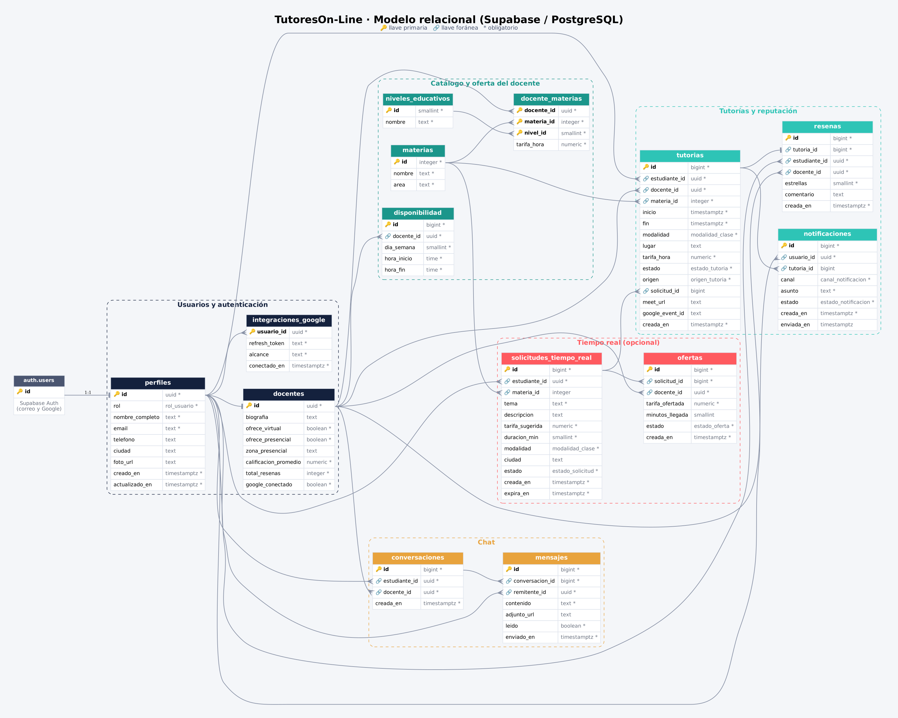

# TutoresOn-Line

Plataforma de tutorías en línea y presenciales que conecta estudiantes con tutores calificados. Proyecto final de **Desarrollo Web**, grupo **24230**.

**Product Owner:** Prof. Edgar Morillo

## Integrantes

| Nombre | Rol en el equipo |
|---|---|
| Jorge Estiven Burgos Ortega | Líder técnico / Scrum Master |
| _(nombre)_ | Desarrollador |
| _(nombre)_ | Desarrollador |
| _(nombre)_ | Desarrollador |

## Enlaces

* **Repositorio:** _(URL de GitHub)_
* **Aplicación publicada:** _(URL del hosting)_

## Cómo recorrer la aplicación

La aplicación arranca en el login (`index.html`). Desde ahí se puede entrar como estudiante o como docente con los botones de **Recorrido de demostración**, o crear una cuenta en **Registrarse**.

| # | Pantalla | Archivo | Rol |
|---|---|---|---|
| 1 | Login | `index.html` | Todos |
| 2 | Registro | `registro.html` | Todos |
| 3 | Inicio del estudiante | `estudiante/inicio.html` | Estudiante |
| 4 | Agendar clase | `estudiante/agendar.html` | Estudiante |
| 5 | Agendar en tiempo real (opcional) | `estudiante/tiempo-real.html` | Estudiante |
| 6 | Inicio del docente | `docente/inicio.html` | Docente |
| 7 | Disponibilidad | `docente/disponibilidad.html` | Docente |
| 8 | Solicitudes en tiempo real (opcional) | `docente/solicitudes.html` | Docente |
| 9 | Chat | `compartidas/chat.html` | Ambos |
| 10 | Clases virtuales | `compartidas/clases-virtuales.html` | Ambos |

Las pantallas 5 y 8 corresponden a la reserva en tiempo real (estilo InDrive / Uber), que es una funcionalidad opcional. Están diseñadas y navegables; la decisión de implementar su lógica completa se tomará más adelante según el tiempo y el alcance del equipo.

## Diseño responsive: una sola versión para web y móvil

Cada pantalla es **un único archivo HTML** que se adapta al tamaño del dispositivo con CSS (`css/styles.css`, punto de quiebre en 860 px):

* **En computador (versión web):** menú en la parte superior, contenido en columnas y tarjetas en cuadrícula.
* **En celular (versión móvil):** barra de navegación fija en la parte inferior, contenido en una sola columna y filtros deslizables.

Para verlo, basta con abrir cualquier pantalla y reducir el ancho de la ventana, o usar el modo de dispositivo móvil de las herramientas de desarrollador del navegador.

Cada rol tiene su color de acento para que el usuario sepa siempre en qué contexto está: **turquesa** para el estudiante, **ámbar** para el docente y **coral** para todo lo que ocurre en tiempo real.

## Por qué hay un archivo de JavaScript

Las interfaces están construidas solo con **HTML y CSS**. Los formularios, los selectores de horario, la cuadrícula de disponibilidad, el cambio entre "Estudiante" y "Docente" en el registro y las ventanas de confirmación funcionan sin programación (usan casillas, botones de opción y el selector `:target` de CSS).

El proyecto incluye **un único archivo de JavaScript**, `js/rol.js`, de unas 30 líneas y **sin lógica de negocio**. Existe por una decisión de diseño:

* **El problema:** el Chat y las Clases virtuales los usan los dos roles, pero el menú cambia (el estudiante ve "Agendar", el docente ve "Disponibilidad") y también el color de acento y la lista de contactos.
* **Sin JavaScript** habría que tener dos copias casi idénticas de esas pantallas (una por rol), es decir, código duplicado que hay que mantener sincronizado.
* **Con `rol.js`** hay un solo archivo por pantalla. El script solo lee qué rol entró (del enlace `?rol=docente` o del último rol usado, guardado en el navegador) y lo marca en la página; el CSS se encarga de mostrar el menú y el color correctos.
* **Si el navegador tiene JavaScript apagado**, la pantalla igual se ve completa, con la vista de estudiante por defecto.

Esto sigue el principio de no repetir código y deja cada pantalla con una sola fuente de verdad.

## Base de datos (Supabase / PostgreSQL)

La carpeta `database/` contiene el diseño relacional completo:

| Archivo | Contenido |
|---|---|
| `schema.sql` | Tablas, relaciones, reglas de negocio, vistas y seguridad por filas |
| `seed.sql` | Catálogos iniciales: niveles educativos y materias |
| `seed_demo.sql` | Usuarios y datos de demostración (los mismos de las pantallas) |
| `diagrama-er.png` / `.svg` | Diagrama entidad relación |
| `diagrama-er.dot` | Fuente del diagrama (Graphviz) |



### Tablas

| Grupo | Tablas | Para qué sirven |
|---|---|---|
| Usuarios | `perfiles`, `docentes`, `integraciones_google` | Datos de cada usuario, rol, reputación del docente y conexión con Google Calendar |
| Catálogo | `materias`, `niveles_educativos`, `docente_materias`, `disponibilidad` | Qué enseña cada docente, en qué nivel, a qué tarifa y en qué horarios |
| Tutorías | `tutorias`, `resenas`, `notificaciones` | Clases agendadas, calificación por estrellas y avisos por correo, SMS o WhatsApp |
| Tiempo real (opcional) | `solicitudes_tiempo_real`, `ofertas` | Solicitudes del estudiante con precio sugerido y ofertas de los docentes |
| Chat | `conversaciones`, `mensajes` | Mensajería entre estudiante y docente |

### Reglas de negocio que cuida la propia base de datos

* Al registrarse (con correo o con Google), se crea el perfil automáticamente con el rol elegido.
* Un docente **no puede tener dos clases que se crucen** en el mismo horario.
* Solo se puede calificar una tutoría **completada**, y solo la califica el estudiante que la tomó.
* La **reputación** (promedio de estrellas y número de reseñas) se recalcula sola con cada reseña.
* Al **aceptar una oferta** en tiempo real se crea la tutoría, se asigna la solicitud y se rechazan las demás ofertas en una sola operación (función `aceptar_oferta`).
* **Seguridad por filas (RLS):** cada usuario solo ve sus tutorías, conversaciones y notificaciones. Los permisos de Google Calendar solo los puede leer el servidor, nunca el navegador.

### Cómo instalarla en Supabase

1. Crear un proyecto en [supabase.com](https://supabase.com).
2. Ir a **SQL Editor**, pegar el contenido de `database/schema.sql` y presionar **Run**.
3. Repetir con `database/seed.sql`.
4. Opcional: repetir con `database/seed_demo.sql` para cargar los usuarios de demostración (contraseña de todos: `Demo1234*`).
5. Para el ingreso con Google: **Authentication > Providers > Google**, con las credenciales creadas en Google Cloud Console.

## Estructura del proyecto

```
tutoresonline/
├── index.html                  Login
├── registro.html               Registro
├── estudiante/                 Pantallas propias del estudiante
├── docente/                    Pantallas propias del docente
├── compartidas/                Chat y Clases virtuales (ambos roles)
├── css/styles.css              Estilos únicos, responsive
├── js/rol.js                   Único script: rol en pantallas compartidas
└── database/                   Base de datos para Supabase
```

## Cómo publicarla gratis

**GitHub Pages:** subir el proyecto a un repositorio, ir a **Settings > Pages**, elegir la rama `main` y la carpeta raíz. En un par de minutos queda publicada en `https://usuario.github.io/repositorio/`.

**Netlify o Vercel:** arrastrar la carpeta del proyecto en su panel; no requiere configuración porque son archivos estáticos.

Para verla en el computador sin publicarla, basta con abrir `index.html` en el navegador.

## Tecnologías

* HTML5 semántico y CSS3 (Grid, Flexbox, variables CSS, media queries)
* Tipografías Fraunces e Inter (Google Fonts)
* PostgreSQL en Supabase (Auth, Row Level Security, Realtime)
* Google Calendar API para crear el evento y el enlace de Google Meet de cada clase
